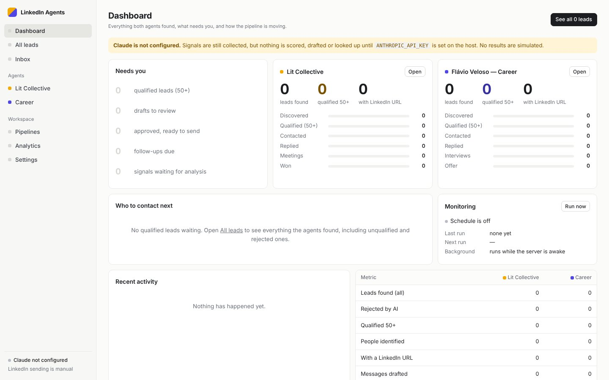
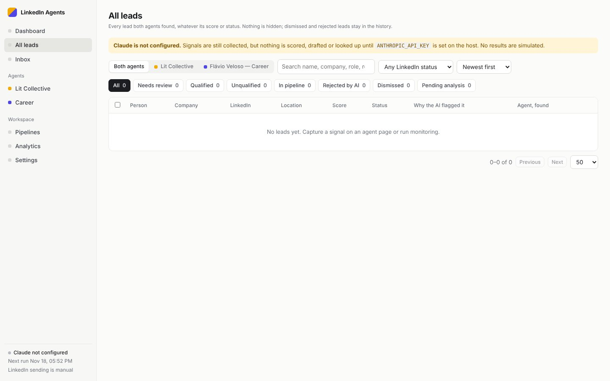
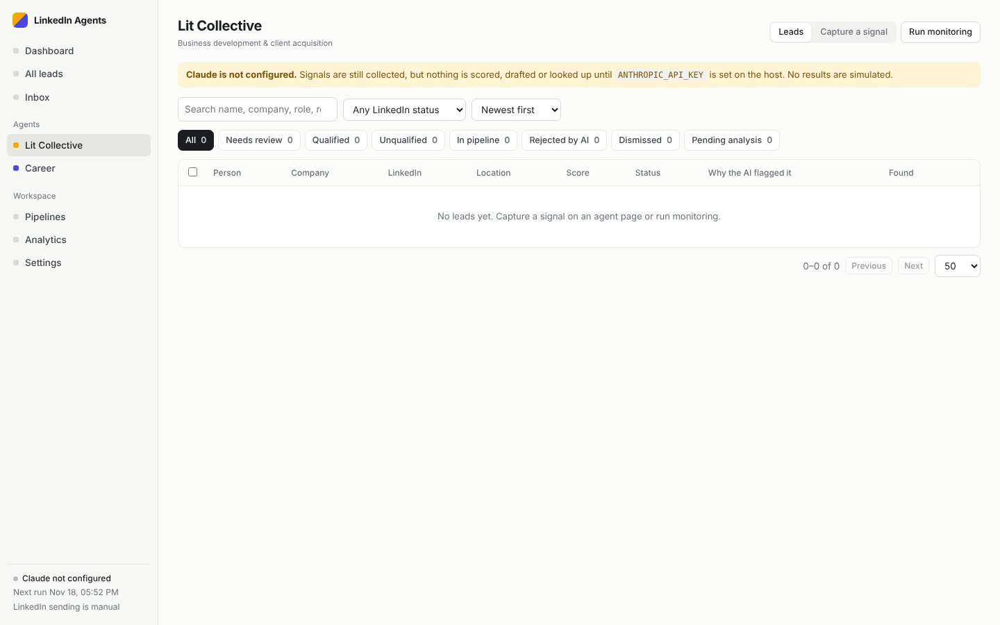
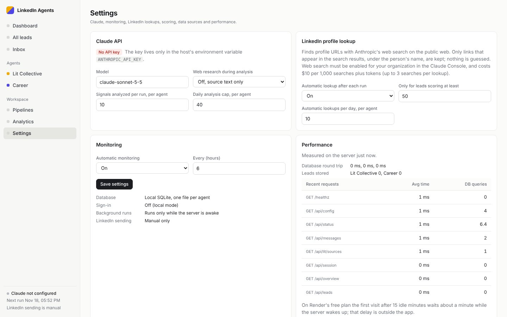
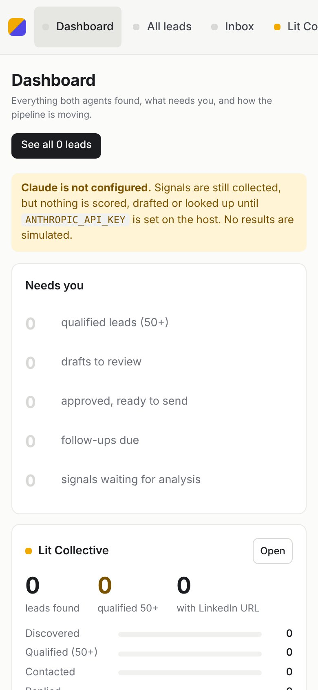

# LinkedIn Agents

Two AI agents that turn public signals into qualified LinkedIn leads, scored and drafted by Claude, with every message approved and sent by hand.

- **Agent 01 — Lit Collective:** finds companies showing buying signals for design, branding, product design, web and creative support.
- **Agent 02 — Flávio Veloso, Career:** finds remote roles and companies (including ones with no public vacancy) that fit a growth, BD, marketing and Web3 profile.

Claude scores every signal against the agent's own rubric, explains each score, proposes who to contact and drafts the outreach. You approve every message and send it yourself.

**Live:** private deployment (password sign-in). Deploy your own with [`DEPLOY.md`](DEPLOY.md).



## What's inside

| Page | What it does |
| --- | --- |
| **Dashboard** | What needs you, both agents' funnels, who to contact next, monitoring status and recent activity. |
| **All leads** | Everything both agents found: qualified, unqualified, rejected by the AI (with score and reason), dismissed, and pending. Filter, search and act in bulk. |
| **Inbox** | New leads and drafted messages from both agents, plus **Capture** to paste a LinkedIn post, profile or job description. |
| **Lit Collective · Career** | Each agent's own leads, scoring rubric, pipeline stages and message types. |
| **Pipelines · Analytics** | Stage-by-stage boards and per-agent metrics. |
| **Settings** | Claude model and spend caps, monitoring interval, LinkedIn profile lookup, scoring weights, data sources and performance. |

<table>
  <tr>
    <td></td>
    <td></td>
  </tr>
  <tr>
    <td></td>
    <td align="center"></td>
  </tr>
</table>

### What it does and does not do with LinkedIn

LinkedIn gives individual developers no API for reading other members' profiles or posts, searching people, or sending invitations and messages, and its User Agreement prohibits scraping and automated activity. So this platform never logs in to LinkedIn, never uses your session and never sends anything.

| Need | How it is handled |
|---|---|
| LinkedIn posts, profiles, job posts you see | Paste the text into **Inbox → Capture** (labelled *User-provided*) |
| Job openings and funding / launch news | Fetched on a schedule from public job-board APIs (Greenhouse, Lever, Ashby, Remotive) and RSS feeds (labelled *Retrieved data*) |
| Company background | Optional Claude web search over public pages (labelled *Public information*; off by default) |
| Anything Claude infers | Labelled *AI hypothesis*; drafts are told not to state hypotheses as fact |
| Finding the right person and their LinkedIn URL | Claude names the person or role; a profile URL is kept only if it appears in Anthropic web search results under that person's name, in the source text, or you paste it. Otherwise the lead is flagged "LinkedIn URL missing" |
| Sending | Approve → Copy → send on LinkedIn → mark as sent |
| Replies | You log them (positive / neutral / negative) |
| Your connections | Import `Connections.csv` from LinkedIn's own data export; known contacts are flagged |

### Keeping the two agents apart

- Separate database, persona, scoring rubric, pipeline stages, message types and analytics per agent.
- If the same company or person shows up in both pipelines, both records are flagged and approval is blocked until you confirm which identity makes the approach.
- Drafts are checked for wording from the other identity (a job-seeking phrase in a Lit message, an agency pitch in a career message).

### Scheduled monitoring

Enabled sources are fetched every 6 hours (configurable) and the newest signals are analyzed up to a per-run and per-day cap, so API spend stays bounded. In the cloud a GitHub Actions schedule wakes the app for each run; locally it runs only while the app is open.

## Built with

- **Python 3** standard library HTTP server (`http.server`), no web framework
- **Claude API** (Messages API with tool use and web search), called directly over HTTPS
- **SQLite** locally, **PostgreSQL** in the cloud via **psycopg 3** (one schema per agent, tested on Neon)
- Vanilla **JavaScript**, HTML and CSS front end, no build step
- **Render** Blueprint (`render.yaml`) for hosting and **GitHub Actions** for scheduled runs

## Project structure

```
.
├── app.py                 # HTTP server, API routes, sign-in, cron endpoint
├── core/
│   ├── agents.py          # the two agents: personas, rubrics, stages, message types
│   ├── claude.py          # Claude Messages API client and web search
│   ├── engine.py          # analysis, scoring, drafting, lead and message actions
│   ├── sources.py         # RSS and job-board fetchers
│   └── db.py              # SQLite / Postgres layer and settings
├── public/                # front end: index.html, app.js, styles.css
├── tests/                 # end-to-end test suite and benchmark (mock Claude API)
├── .github/workflows/     # scheduled monitoring
├── docs/                  # screenshots used in this README
├── render.yaml            # Render Blueprint
├── DEPLOY.md              # cloud deployment guide
├── .env.example
├── requirements.txt
└── start.bat              # one-click start on Windows
```

## Run locally

Python 3.9+.

```bash
cp .env.example .env        # then add your ANTHROPIC_API_KEY
python app.py               # Windows: start.bat
```

Open http://127.0.0.1:8765. Local mode uses SQLite files in `data/` and has no sign-in because it only listens on localhost. Without an API key the app still runs and collects signals, but nothing is scored or drafted. Only the cloud mode needs `pip install -r requirements.txt` (the Postgres driver).

Run the tests (mock Claude API and mock feed, no key needed):

```bash
python tests/run_tests.py
```

Set `DATABASE_URL` to run the same suite on Postgres.

## Known limits

- The default feed URLs and job-board endpoints could not be called from the build environment. Use **Fetch now** on each source; a failing source shows its error and can be edited or deleted.
- The Claude integration was verified against a mock of the Messages API, not with a live key. If your account uses a different model name, change it under **Settings**.
- Calendar: meetings and interviews export as `.ics` files; there is no live calendar sync.

## Contact

- [LinkedIn](https://www.linkedin.com/in/fl%C3%A1vio-veloso-a29b02254/)
- [X @flaviovlso](https://x.com/flaviovlso)
- [github.com/flaviohcveloso](https://github.com/flaviohcveloso)

---

© 2026 Flávio Veloso. All rights reserved.
